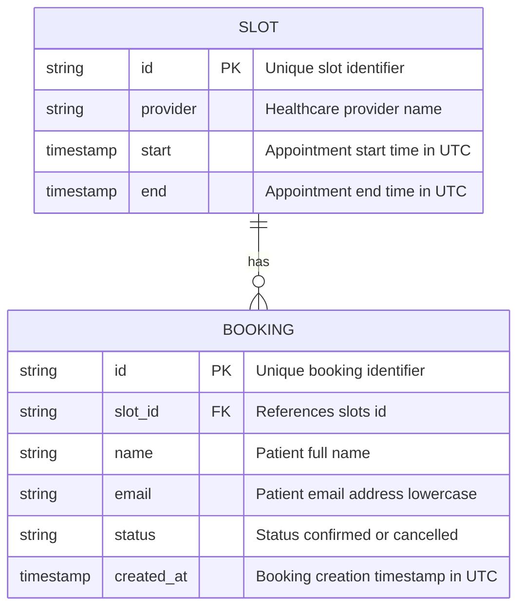

# Clinic Booking API — Entity Relationship Diagram (ERD)

This document specifies the database design, entity relationships, primary/foreign key constraints, and concurrency integrity rules for the Clinic Booking API.

---

## 1. Visual Entity Relationship Diagram (ERD)



---

## 2. Entity Details and Attributes

### 2.1 `slots` Entity

Represents an appointment window offered by a clinic practitioner.

| Attribute | Database Type | Constraints | Description |
|---|---|---|---|
| `id` | `VARCHAR(64)` | `PRIMARY KEY` | Unique slot identifier provided by the clinic (e.g. `"s1"`). |
| `provider` | `VARCHAR(255)` | `NOT NULL` | Name of the healthcare provider offering the slot (e.g. `"Dr Ade"`). |
| `start` | `TIMESTAMP WITH TIME ZONE` | `NOT NULL` | Start time of the appointment in UTC. |
| `end` | `TIMESTAMP WITH TIME ZONE` | `NOT NULL` | End time of the appointment in UTC. |

#### Slots Indexes:
- **Primary Key:** `slots_pkey` on `id`.
- **Sorting Index:** `idx_slots_start` on `start ASC` (optimizes `GET /slots` which returns earliest appointments first).
- **Filtering Index:** `idx_slots_provider` on `provider` (optimizes `GET /slots?provider=...`).

---

### 2.2 `bookings` Entity

Represents a patient's reservation of a specific appointment slot.

| Attribute | Database Type | Constraints | Description |
|---|---|---|---|
| `id` | `VARCHAR(64)` | `PRIMARY KEY` | Unique booking identifier generated on creation (e.g. UUID string `"b1a2c3d4-..."`). |
| `slot_id` | `VARCHAR(64)` | `NOT NULL, FOREIGN KEY` | References the booked slot (`slots.id`). |
| `name` | `VARCHAR(255)` | `NOT NULL` | Patient's full name (trimmed of extraneous whitespace). |
| `email` | `VARCHAR(255)` | `NOT NULL` | Patient's email address (stored in normalized lowercase). |
| `status` | `VARCHAR(20)` | `NOT NULL, CHECK (status IN ('confirmed', 'cancelled'))` | Booking status. Only `'confirmed'` and `'cancelled'` are allowed. |
| `created_at` | `TIMESTAMP WITH TIME ZONE` | `NOT NULL, DEFAULT NOW()` | Timestamp when the booking was initiated. |

#### Bookings Indexes and Constraints:
- **Primary Key:** `bookings_pkey` on `id`.
- **Foreign Key Index:** `idx_bookings_slot_id` on `slot_id`.
- **Check Constraint:** `chk_booking_status` enforcing `CHECK (status IN ('confirmed', 'cancelled'))`.
- **Partial Unique Index (Double-Booking Prevention):**
  ```sql
  CREATE UNIQUE INDEX uq_confirmed_slot_booking ON bookings (slot_id) WHERE status = 'confirmed';
  ```
- **Email Index:** `idx_bookings_email` on `email` (supports efficient lookup for patient bookings).

---

### 2.3 Status Enforcement: `confirmed` and `cancelled`

The booking lifecycle supports only two states:
- `'confirmed'`: The appointment slot is actively reserved for the patient.
- `'cancelled'`: The reservation was cancelled by the patient and the slot has become available again.

#### Database Enforcement:
During model and migration implementation, the database will enforce this constraint using either:
1. A database-level `CHECK` constraint:
   ```sql
   ALTER TABLE bookings ADD CONSTRAINT chk_booking_status CHECK (status IN ('confirmed', 'cancelled'));
   ```
2. A SQLAlchemy `Enum` constraint (`Enum("confirmed", "cancelled", name="booking_status")`).

This ensures that no invalid or arbitrary status values can be inserted or updated at the database level.

---

### 2.4 Entity Simplicity (No Unnecessary Tables)

In strict adherence to the assessment requirements:
- No separate `Patient`, `User`, `Clinic`, or `Practitioner` tables are introduced.
- Patient information (`name`, `email`) is stored directly on the `Booking` entity.
- Practitioner information (`provider`) is stored directly on the `Slot` entity.
- This design satisfies all requirements for Levels 1–3 without overengineering or unnecessary relational overhead.

---

## 3. Primary Keys and Foreign Keys

### Primary Keys (PK)
- **What they are:** A column (or set of columns) that guarantees each row in a database table can be uniquely identified.
- **Why we need them:**
  - `slots.id` uniquely identifies each appointment slot.
  - `bookings.id` uniquely identifies each booking transaction.
  - Primary keys automatically create a unique B-tree index, guaranteeing $O(\log n)$ lookup speed when retrieving records by ID (`GET /bookings/{id}`).

### Foreign Keys (FK)
- **What they are:** A column in one table that points directly to the primary key of another table, establishing relational integrity.
- **Why we need them:**
  - `bookings.slot_id` points to `slots.id`.
  - The database rejects any booking request that references a non-existent `slot_id` with a foreign key violation.
  - Supports referential integrity: ensures orphaned bookings cannot exist without a valid slot.

---

## 4. Why the One-to-Many Relationship Allows Historical Bookings

A single appointment slot can have **multiple booking records over time**, creating a 1-to-many relationship (`slots 1 ──< bookings`):

```text
Slot s1 (Dr Ade: 09:00 - 09:30)
 ├── Booking 1: Patient A (Ada Obi)  ── status: "cancelled"  (Created 08:00, Cancelled 08:30)
 └── Booking 2: Patient B (Kemi S.)  ── status: "confirmed"  (Created 08:45)
```

### Why we retain cancelled bookings instead of deleting them:
When a patient cancels an appointment, the booking row is not deleted; its status is updated from 'confirmed' to 'cancelled'. This preserves a historical record of past reservations while freeing the slot for other patients. These records are historical rather than strictly immutable, as their status changes upon cancellation and rows can be cleared during a /reset operation.

1. **Auditability & Clinical Records:** Clinics need a historical record of who reserved appointments and when they cancelled.
2. **Patient History:** Patients can query their booking history (including past and cancelled appointments).
3. **Slot Recycling:** Cancelling does not delete the slot or the historical booking row; it simply updates `status = 'cancelled'`.

---

## 5. Concurrency Protection & Partial Unique Index

### The Race Condition Problem (Check-Then-Act)
In a clinic booking system, two patients may attempt to book the same available slot `s1` at the exact same millisecond:

```text
Patient A (Request 1)                Patient B (Request 2)
      │                                    │
      ├────── SELECT slot s1 ─────────────┤ (Checks: Is slot s1 booked?)
      │       Result: Available           │ (Result: Available)
      │                                    │
      ├────── INSERT Booking (s1) ────────┤ (Both believe slot is free!)
      │       Status: confirmed           │ Status: confirmed
      ▼                                    ▼
       ❌ DISASTER: Two confirmed bookings for the same slot!
```

Checking availability in Python code (`if slot.is_available:`) is **insufficient** because between the check and the insert, another concurrent request can commit a booking.

### The Solution: PostgreSQL Partial Unique Index

We enforce the business invariant directly inside the PostgreSQL database engine:

```sql
CREATE UNIQUE INDEX uq_confirmed_slot_booking
ON bookings (slot_id)
WHERE status = 'confirmed';
```

### How this solves the problem:
1. **Targeted Uniqueness:** The unique constraint applies **only** to rows where `status = 'confirmed'`.
2. **Allows Multiple Cancelled Rows:** A slot can have multiple rows with `status = 'cancelled'` and the index ignores them because they do not match `WHERE status = 'confirmed'`.
3. **Guarantees Concurrency Protection:** When Request 1 and Request 2 arrive simultaneously:
   - PostgreSQL allows the first transaction to insert a row with `(slot_id='s1', status='confirmed')`.
   - When the second transaction tries to insert `(slot_id='s1', status='confirmed')`, PostgreSQL immediately detects a unique key violation (`UniqueViolation` / SQLSTATE `23505`).
   - The second transaction is rejected at the database engine level, and our Service layer catches the error and cleanly returns HTTP `409 Conflict`.
